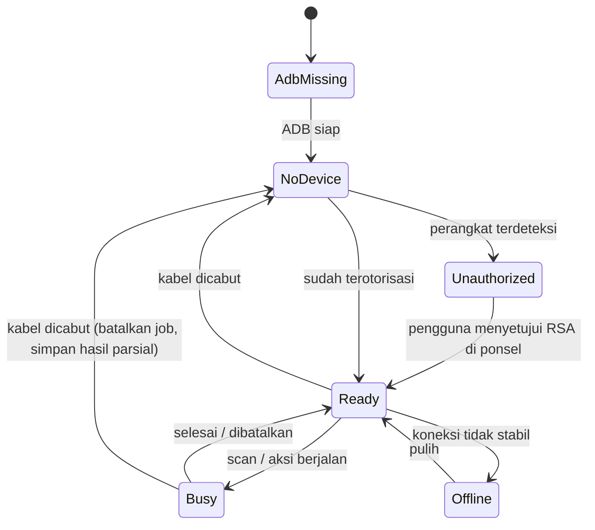
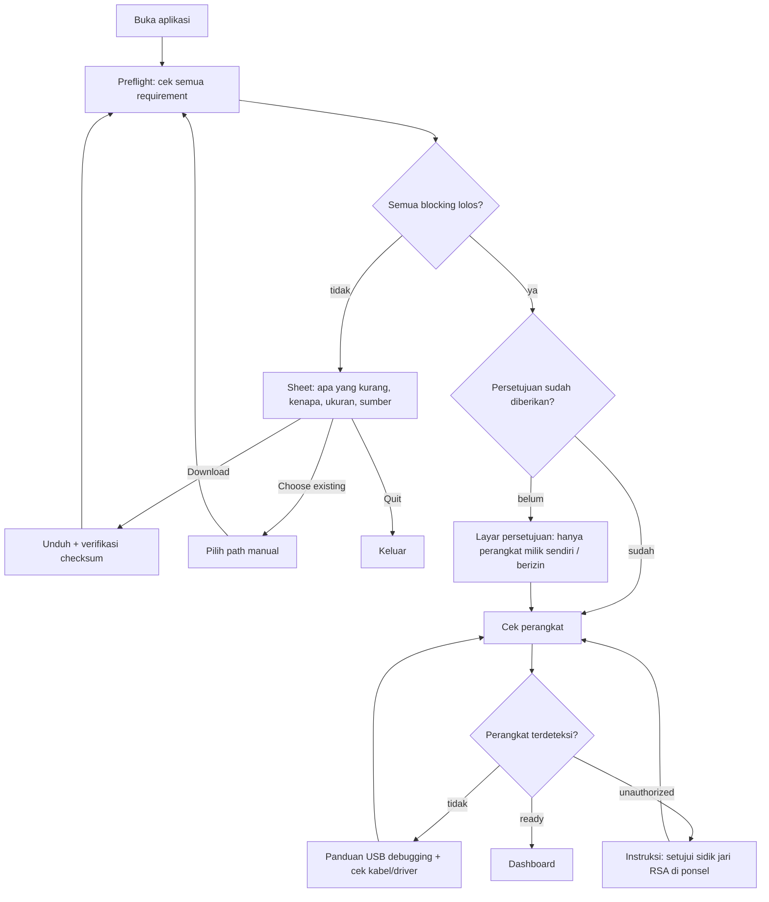

# PRD — Jerion: Android Threat Analyzer

| | |
|---|---|
| **Status** | Draft v1.1 — keputusan owner (nama, Wails v2, preflight ADB, UI English, repo privat, perangkat uji) sudah dimasukkan |
| **Tanggal** | 2026-10-11 |
| **Platform utama** | Windows 10/11 x64 (macOS & Linux: build diverifikasi, bukan target rilis awal) |
| **Stack** | Wails v2 · Go · React · TypeScript · Tailwind CSS · Aceternity UI · Three.js |
| **Bahasa UI** | English (satu bahasa di v1; string tetap lewat lapisan i18n) |
| **Perangkat uji utama** | Infinix Note 11S — XOS 10.6 (Android 12, API 31) |
| **Repo** | Publik (GitHub: `EnoughForYou/Jerion`) |
| **Referensi UX** | Apple (kejelasan, hierarki, ketenangan visual) + 3uTools (navigasi kiri, header perangkat, kartu info padat) |
| **Dokumen pendamping** | `AGENTS.md` (konteks wajib untuk AI agent), `docs/PROGRESS.md`, `docs/adr/` |

> Nama produk final: **Jerion**.

---

## 1. Overview

### 1.1 Ringkasan
Aplikasi desktop yang terhubung ke perangkat Android lewat USB/ADB, lalu **menganalisis** apakah perangkat terindikasi adware, popup iklan agresif, stalkerware/spyware, dropper, dan malware berbahaya lain — beserta **tindakan pembersihan terkontrol**. Pola pakainya mirip 3uTools (colok → perangkat terbaca → semua fitur ada di sidebar), tetapi fokusnya keamanan, bukan manajemen file/flash.

### 1.2 Masalah yang diselesaikan
- Adware di Android sering menyamar (ikon disembunyikan, nama mirip sistem, muncul popup di luar aplikasinya), dan pengguna tidak tahu **aplikasi mana** pemicunya.
- Antivirus mobile umumnya kotak hitam: skor/persen tanpa bukti.
- Pengguna tingkat menengah sulit membaca output `dumpsys`/`pm`/`appops` secara manual.

### 1.3 Tujuan
1. Mengidentifikasi aplikasi pemicu popup/iklan dalam beberapa langkah (**Popup Hunter**).
2. Memberi **temuan berbasis bukti**: setiap flag punya alasan, bukti mentah, severity, dan confidence.
3. Membersihkan dengan aman: konfirmasi, backup APK, log aksi, dan opsi undo bila memungkinkan.
4. UI/UX setingkat produk desktop yang rapi, padat informasi, dan konsisten.

### 1.4 Non-goals (v1)
- Bukan pengganti antivirus real-time; tidak ada proteksi latar belakang di ponsel.
- Tidak butuh dan tidak mengajarkan root; tidak ada eksploit, bypass lock, atau flash/unlock bootloader.
- Tidak mengunggah APK/data ke server mana pun secara default.
- Tidak mendukung iPhone.
- Tidak ada akun, cloud sync, atau telemetri.

### 1.5 Pengguna target
| Persona | Kebutuhan | Prioritas |
|---|---|---|
| **Pengguna awam** yang HP-nya penuh popup | Alur 3 langkah, bahasa jelas, tombol "bersihkan" yang aman | Utama |
| **Teknisi servis / pelajar RPL-TKJ** | Detail teknis, ekspor laporan, bukti mentah | Utama |
| **Analis/penggemar keamanan** | Aturan deteksi yang bisa dibaca dan ditambah | Sekunder |

### 1.6 Prinsip produk
1. **Bukti, bukan skor palsu.** Tidak ada "99% aman". Verdict = jumlah temuan per severity.
2. **Jujur soal batas.** Tanpa root, data aplikasi lain tidak terbaca. UI menyebut ini, bukan menyembunyikannya.
3. **Aman secara default.** Aksi destruktif selalu minta konfirmasi dan tercatat.
4. **Tenang secara visual.** Satu aksen warna, gerak seperlunya, tidak dekoratif.

### 1.7 Kemampuan & keterbatasan realistis (WAJIB dipahami agent)
ADB (user `shell`, tanpa root) **bisa**: baca daftar paket, izin, installer, waktu instal, `dumpsys`, `appops`, `settings`, tarik APK (`pm path` + `pull`), pantau logcat sistem, uninstall/disable per-user, revoke izin.
**Tidak bisa**: baca data privat aplikasi lain, baca sertifikat CA user (`/data/misc/user`), memindai memori/proses secara mendalam, melihat isi traffic. Fitur yang butuh itu **di luar scope** atau ditandai "terbatas tanpa root".

---

## 2. Requirements

### 2.1 Functional Requirements
Prioritas: **P0** wajib v1.0 · **P1** v1.0 bila waktu cukup · **P2** pasca-v1.0.

| ID | Requirement | Prio | Fase |
|---|---|---|---|
| FR-01 | **Preflight tiap peluncuran**: cek semua requirement (ADB, ADB server, data dir/DB, paket aturan, dll.); bila ada yang belum ada → layar info + tawaran unduh/pilih manual (tanpa unduh diam-diam) | P0 | 1 (UI) · 2 (logika) |
| FR-02 | Deteksi perangkat realtime (hotplug) beserta state: `unauthorized`, `offline`, `ready` | P0 | 2 |
| FR-03 | Onboarding aktifkan USB debugging; v1 terverifikasi untuk **Infinix/XOS** (perangkat uji) + generic AOSP/Pixel; merek lain ditandai "belum diverifikasi" sampai diuji | P0 | 2 |
| FR-04 | Dashboard info perangkat: model, Android/SDK, security patch, fingerprint, baterai, storage, status bootloader/verified boot, indikator root | P0 | 2 |
| FR-05 | Inventaris aplikasi: paket, label, versi, UID, installer, waktu instal/update, system/user, enabled/disabled | P0 | 3 |
| FR-06 | Detail aplikasi: izin diminta vs diberikan, komponen (activity/service/receiver), sertifikat penanda tangan, hash APK | P0 | 3 |
| FR-07 | Tarik APK (termasuk split) ke folder kerja, hitung SHA-256 | P0 | 3 |
| FR-08 | Quick Scan (metadata + heuristik izin, tanpa tarik APK) | P0 | 4 |
| FR-09 | Deep Scan (tarik APK, parse manifest & dex, deteksi ad SDK, hash intel) | P0 | 4 |
| FR-10 | Rule engine deklaratif (YAML) dengan severity, confidence, kategori, bukti | P0 | 4 |
| FR-11 | System Audit: accessibility, notification listener, device admin, overlay (SYSTEM_ALERT_WINDOW), default SMS/launcher/IME, proxy, private DNS, ADB-over-Wi-Fi, install unknown sources, Play Protect | P0 | 5 |
| FR-12 | **Popup Hunter**: monitor perpindahan foreground/overlay/notifikasi dan atribusi ke paket pemicu | P0 | 6 |
| FR-13 | Remediation: force-stop, disable, uninstall, revoke izin, deny appop; konfirmasi + backup APK + log aksi | P0 | 7 |
| FR-14 | Undo yang mungkin (`install-existing`, re-enable, re-grant) dan riwayat aksi | P1 | 7 |
| FR-15 | Panduan manual untuk kasus yang tidak bisa via ADB (device admin aktif, accessibility terkunci) | P0 | 7 |
| FR-16 | Daftar "tandai aman" (allowlist per paket + hash sertifikat) | P0 | 7 |
| FR-17 | Laporan HTML + JSON (PDF = P1) berisi bukti, hash, timestamp, versi aturan | P0 | 8 |
| FR-18 | Intel hash lokal (SQLite) + impor daftar hash buatan pengguna | P0 | 8 |
| FR-19 | Lookup hash ke VirusTotal (hash saja; unggah file opt-in per file); API key di OS keychain | P1 | 8 |
| FR-20 | Pairing Wireless debugging (Android 11+) | P1 | 9 |
| FR-21 | Riwayat scan & perbandingan antar scan (apa yang baru muncul) | P1 | 8 |
| FR-22 | UI **English-only** di v1; semua string lewat lapisan i18n (`en.json`) agar bahasa lain bisa ditambah tanpa refactor | P0 | 1 |
| FR-23 | Pembaruan aturan tanpa update aplikasi (paket aturan bertanda tangan) | P2 | — |
| FR-24 | YARA / analisis lanjutan | P2 | — |

### 2.2 Non-Functional Requirements
| ID | Kategori | Requirement |
|---|---|---|
| NFR-01 | Performa | Cold start ≤ 2 dtk; tabel 500+ paket tetap mulus (virtualized); UI tidak freeze saat scan |
| NFR-02 | Performa scan | Quick Scan ≤ 20 dtk; Deep Scan ≤ 90 dtk untuk ±100 aplikasi pihak ketiga (target, **diukur** di Fase 4 dan dicatat di PROGRESS) |
| NFR-03 | Keandalan | Semua perintah ADB punya timeout & cancel; cabut kabel di tengah scan tidak membuat crash; state pulih |
| NFR-04 | Kompatibilitas | Target Android 9 (API 28) – terbaru. **Terverifikasi di perangkat nyata: Android 12 (XOS 10.6)**; versi/OEM lain lewat fixture emulator dan ditandai "belum diverifikasi". Parser defensif terhadap variasi output antar versi/OEM |
| NFR-05 | Keamanan | Tidak ada data keluar tanpa aksi eksplisit pengguna; secrets hanya di keychain; tidak ada eksekusi shell dari input mentah |
| NFR-06 | Privasi | Tanpa telemetri; laporan punya opsi redaksi serial/identitas perangkat |
| NFR-07 | Aksesibilitas | Navigasi keyboard penuh, fokus terlihat, kontras WCAG AA, hormati `prefers-reduced-motion` |
| NFR-08 | UI | Ukuran jendela minimum 1100×700; DPI scaling 100–200% rapi; tema gelap & terang |
| NFR-09 | Observabilitas | Log terstruktur ke file lokal dengan rotasi; mode debug menampilkan perintah ADB mentah |
| NFR-10 | Maintainability | Aturan deteksi dipisah dari kode (data, bukan if-else); cakupan test inti ≥ 70% pada `internal/engine`, `internal/adb` parser |
| NFR-11 | Ukuran | Binary + aset ≤ 60 MB (di luar ADB yang diunduh) |

### 2.3 Asumsi & dependensi
- Pengguna bisa mengaktifkan USB debugging di perangkatnya sendiri.
- WebView2 Runtime tersedia (Windows 11 bawaan; Windows 10 → installer memeriksa/menginstal). Bila WebView2 hilang, UI tidak bisa tampil sama sekali, jadi ini **tidak bisa dicek oleh preflight di dalam aplikasi** — ditangani installer (bootstrapper).
- ADB resmi dari Google. **Keputusan (ADR-0002): tidak dibundel.** Preflight mendeteksi ADB (path manual → ADB sistem → salinan milik aplikasi); bila tidak ada, pengguna ditawari unduh dari sumber resmi Google dengan verifikasi checksum, atau memilih path sendiri. Tidak ada unduhan tanpa persetujuan.

### 2.4 Etika & hukum
- Hanya untuk perangkat milik sendiri atau dengan izin tertulis pemiliknya. Layar persetujuan pada first-run.
- Dilarang menambahkan fitur yang dapat dipakai memata-matai orang lain (ekstraksi pesan, lokasi, dsb.).
- Bahasa hasil: "terindikasi", "temuan", bukan "pasti virus". Tampilkan false-positive wajar dan cara menandai aman.

---

## 3. Core Features

Setiap modul: **Sumber data → Output → Batasan**.

### 3.0 Preflight — pengecekan requirement tiap peluncuran (FR-01)
Dijalankan **setiap aplikasi dibuka**, sebelum UI utama. Semua check nyata; **tidak ada delay atau animasi palsu** — bila semua lolos, layar langsung berganti ke aplikasi.

| # | Check | Cara | Blocking | Jika gagal |
|---|---|---|---|---|
| P1 | Biner ADB | Resolusi berurutan: path di Settings → `adb` di PATH → salinan milik aplikasi (`%LOCALAPPDATA%\Jerion\tools\platform-tools`), lalu `adb version` | Ya | Sheet requirement: **Download** / **Choose existing…** / **Quit** |
| P2 | ADB server | `adb start-server` (timeout); deteksi bentrok versi | Ya | Coba server privat otomatis; bila gagal tampilkan penyebab + retry |
| P3 | Data dir & DB | Uji tulis folder data, jalankan migrasi SQLite | Ya | Pesan jelas + pilih folder lain |
| P4 | Paket aturan | Validasi YAML ter-embed (skema, ID unik) | Ya | Error fatal berisi detail (ini bug build) |
| P5 | Folder kerja & disk | Uji tulis + ruang kosong minimum (mis. 500 MB) | Tidak | Peringatan + opsi ganti folder |
| P6 | Keychain OS | Uji baca/tulis item percobaan | Tidak | Fitur VirusTotal dinonaktifkan + info |
| P7 | Jaringan | Hanya dicek saat dibutuhkan (unduh ADB / VirusTotal) | Tidak | Pesan offline, fitur terkait ditunda |

Urutan: P1 → P2 berurutan; P3–P6 paralel.

**Sheet "requirement hilang"** (contoh P1) menampilkan: apa yang kurang, kenapa dibutuhkan, ukuran unduhan (dibaca saat itu juga, bukan angka tetap), sumber (domain resmi Google), tujuan simpan. Aksi: **Download** · **Choose existing…** · **Quit**.
- Unduhan hanya lewat HTTPS dari sumber resmi Google; progres nyata; verifikasi checksum sebelum ekstrak. Mekanisme dan algoritma checksum diputuskan di spike Fase 2 (ADR-0002); bila tidak ada checksum yang bisa diverifikasi, unduh **tidak dilanjutkan** tanpa peringatan eksplisit.
- Gagal verifikasi → file dihapus, error ditampilkan, tidak lanjut.
- Pilihan "Choose existing…" disimpan di Settings.
- Driver USB Windows tidak bisa dicek di preflight (tanpa perangkat tidak ada yang dicek). Kasus "terlihat di Windows tapi tidak di ADB" ditangani sebagai panduan pemecahan masalah di layar perangkat (deteksinya P1).

### 3.1 Koneksi & Perangkat (FR-02…04)
- **Sumber**: `adb devices -l` / protokol `host:track-devices-l`; `getprop` (`ro.product.model`, `ro.product.manufacturer`, `ro.build.version.release`, `ro.build.version.sdk`, `ro.build.version.security_patch`, `ro.build.fingerprint`, `ro.build.tags`, `ro.boot.verifiedbootstate`, `ro.boot.flash.locked`, `ro.debuggable`), `dumpsys battery`, `df /data`, `/proc/meminfo`.
- **Indikator root/modifikasi** (bukan vonis): biner `su`, paket Magisk (bisa disembunyikan), `ro.build.tags=test-keys`, `ro.debuggable=1`, verified boot ≠ green.
- **State machine koneksi**:



### 3.2 Inventaris Aplikasi (FR-05…07)
- **Sumber**: `pm list packages -f -i -U --show-versioncode` (+ `-3`/`-s`/`-d` untuk filter), `dumpsys package <pkg>` (izin, `firstInstallTime`, `lastUpdateTime`, `installerPackageName`, tanda tangan, komponen), `pm path <pkg>` + `adb pull`, `cmd package query-activities` (apakah punya ikon launcher).
- **Output**: tabel virtualized (kolom bisa diatur, sort, filter: Sistem/Pihak ketiga/Disabled/Sideload/Berisiko), panel detail di kanan.
- **Batasan**: label aplikasi butuh parsing resource APK (ditunda sampai Deep Scan); sebelum itu tampilkan nama paket. Normalisasi `dumpsys` memakai fixture multi-versi Android.

### 3.3 Threat Scan Engine (FR-08…10)
**Dua mode**
| | Quick Scan | Deep Scan |
|---|---|---|
| Data | Metadata + izin + installer + status appops | + APK ditarik, manifest, dex, sertifikat, hash |
| Waktu | Detik | Menit |
| Deteksi | Heuristik izin/perilaku | + ad SDK, komponen mencurigakan, intel hash |

**Kategori temuan** (taksonomi tetap; ditambah lewat ADR):
`adware`, `aggressive-ads`, `stalkerware`, `banking-trojan-indicators`, `dropper`, `device-admin-abuse`, `system-tampering`, `pua`, `suspicious-install`, `info`.

**Sinyal heuristik** (tiap sinyal = 1 aturan):
- Izin berbahaya & kombinasinya: `SYSTEM_ALERT_WINDOW`, `BIND_ACCESSIBILITY_SERVICE`, `BIND_DEVICE_ADMIN`, `REQUEST_INSTALL_PACKAGES`, `READ_SMS`/`RECEIVE_SMS`, `BIND_NOTIFICATION_LISTENER_SERVICE`, `QUERY_ALL_PACKAGES`, `RECEIVE_BOOT_COMPLETED`, `REQUEST_IGNORE_BATTERY_OPTIMIZATIONS`, `USE_FULL_SCREEN_INTENT`.
- Konteks instalasi: installer bukan Play Store/toko resmi (sideload), baru terpasang, tidak ada launcher activity (ikon tersembunyi), nama paket meniru paket sistem/Google.
- Perilaku manifest: receiver `BOOT_COMPLETED`/`USER_PRESENT`/`PACKAGE_ADDED`, service dengan `exported=true` tanpa permission, `targetSdk` sangat rendah (menghindari pembatasan modern).
- Ad SDK (dex class prefix + string): daftar prefix jaringan iklan. **Keberadaan SDK iklan ≠ malware** → severity `info`/`low`; naik hanya jika bergabung dengan sinyal lain (overlay + boot + tanpa ikon + sideload).
- Intel: hash APK cocok dengan daftar lokal / VirusTotal → `critical` dengan confidence tinggi.

**Skoring** (sengaja sederhana & transparan):
- Tiap temuan: `severity` (`info|low|medium|high|critical`) × `confidence` (`low|medium|high`) × `weight` aturan.
- Skor per aplikasi = jumlah bobot dengan batas atas per kategori (menghindari inflasi dari banyak aturan yang saling tumpang tindih).
- Verdict perangkat (3 level): **Tidak ada temuan signifikan** · **Perlu ditinjau** · **Berisiko tinggi**. Ditampilkan sebagai jumlah temuan per severity, **bukan persen**.
- Setiap temuan wajib punya: `ruleId`, `title`, `whyFlagged` (1–2 kalimat), `evidence[]` (potongan output mentah), `recommendedAction`, `falsePositiveHint`.

**Format aturan** (`internal/rules/*.yaml`, di-embed `go:embed`):

```yaml
id: ADW-003
title: Aplikasi sideload dengan overlay dan auto-start
category: adware
severity: high
confidence: medium
weight: 40
mode: [quick, deep]
when:
  all:
    - installer: { not_in: [com.android.vending, com.sec.android.app.samsungapps, com.xiaomi.mipicks] }
    - permission_granted: android.permission.SYSTEM_ALERT_WINDOW
    - manifest_receiver: android.intent.action.BOOT_COMPLETED
    - launcher_activity: false        # tanpa ikon
why: >
  Aplikasi di luar toko resmi bisa menggambar di atas aplikasi lain, berjalan
  sendiri saat boot, dan tidak punya ikon. Kombinasi ini umum pada adware.
false_positive_hint: Aplikasi enterprise/kiosk dan beberapa utilitas sideload sah memakai pola ini.
remediation: [force_stop, revoke_overlay, disable, uninstall]
```

### 3.4 System Audit (FR-11)
| Item | Sumber | Catatan |
|---|---|---|
| Accessibility aktif | `settings get secure enabled_accessibility_services` | Cocokkan ke paket, tandai yang bukan layanan aksesibilitas dikenal |
| Notification listener | `settings get secure enabled_notification_listeners` | Sering disalahgunakan adware/stalkerware |
| Device admin | `dumpsys device_policy` | Admin aktif milik app non-MDM = bendera merah |
| Overlay diizinkan | `appops get <pkg> SYSTEM_ALERT_WINDOW`; `cmd appops query-op …` bila tersedia | Verifikasi per API level |
| Install unknown sources | `appops get <pkg> REQUEST_INSTALL_PACKAGES` | Kandidat dropper |
| Default SMS / Launcher / IME | `settings get secure sms_default_application`, `cmd package resolve-activity`, `enabled_input_methods` | Pembajakan default app |
| Proxy / Private DNS | `settings get global http_proxy`, `private_dns_mode`, `private_dns_specifier` | Pengalihan traffic/iklan |
| ADB over Wi-Fi | `settings get global adb_wifi_enabled` | Permukaan serangan |
| Play Protect | `settings get global package_verifier_enable` | Verifikasi nama setting per versi |
| VPN aktif | `dumpsys connectivity` | VPN tak dikenal |

> Nama setting/appop berubah antar versi Android. Tiap collector punya **uji dengan fixture per API level** dan fallback "tidak tersedia di perangkat ini" (bukan error).

### 3.5 Popup Hunter (FR-12) — fitur pembeda utama
**Tujuan**: menjawab "popup ini dari aplikasi apa?".
- **Mode**: pengguna menekan *Mulai pantau*, memakai ponsel seperti biasa; saat popup muncul, tekan *Popup baru saja muncul* (atau otomatis) → aplikasi menampilkan kandidat pemicu bertingkat.
- **Sumber sinyal** (dipilih dan divalidasi lewat spike di Fase 6; jangan diasumsikan):
  - Transisi foreground: `logcat` tag `ActivityTaskManager`/`ActivityManager` (`START u0 {... cmp=<pkg>/<activity>}`) dan/atau event log (`wm_set_resumed_activity`, `wm_create_activity`).
  - Jendela overlay: `dumpsys window` (jendela bertipe `TYPE_APPLICATION_OVERLAY`, `mOwnerUid`/paket pemilik).
  - Fokus saat ini: `dumpsys window` (`mCurrentFocus`) / `dumpsys activity activities` (`topResumedActivity`).
  - Notifikasi spam: `dumpsys notification --noredact` (paket pengirim, channel, frekuensi).
  - Riwayat penggunaan: `dumpsys usagestats` (opsional).
- **Atribusi**: peristiwa "paket X menarik Activity ke depan tanpa interaksi pengguna / saat paket lain di foreground" diberi skor; kandidat teratas ditampilkan dengan **linimasa bukti** (timestamp, paket, activity, jenis sinyal).
- **Output**: linimasa (Aceternity Timeline atau komponen sendiri), daftar kandidat, tombol *Selidiki aplikasi* → ke detail aplikasi.
- **Batasan**: Android 10+ membatasi start activity dari background; adware beralih ke overlay, full-screen intent, notifikasi, atau accessibility. Hunter harus mencakup keempatnya.

### 3.6 Remediation (FR-13…16)
Aksi (semuanya melalui `internal/remediate`, tidak ada `adb shell` mentah dari UI):
| Aksi | Perintah dasar | Undo |
|---|---|---|
| Force stop | `am force-stop <pkg>` | — |
| Cabut izin | `pm revoke <pkg> <perm>` / `appops set <pkg> <op> deny` | Re-grant/`appops set … allow` |
| Disable | `pm disable-user --user 0 <pkg>` | `pm enable <pkg>` |
| Uninstall (user app) | `pm uninstall <pkg>` | Pasang ulang dari backup APK |
| Uninstall untuk user 0 (app sistem) | `pm uninstall --user 0 <pkg>` | `cmd package install-existing <pkg>` |

**Guardrail (wajib)**
1. Denylist paket kritis (system UI, telephony, launcher aktif, `com.android.*` inti, GMS inti, keyboard aktif, paket MDM) — tombol dinonaktifkan dengan alasan.
2. Dialog konfirmasi menampilkan: paket, apa yang berubah, bisa/tidak di-undo.
3. Backup APK otomatis sebelum uninstall (jika bisa ditarik).
4. Setiap aksi masuk `actions_log` (waktu, paket, perintah, hasil, undo-token).
5. Mode **Antrian**: pilih banyak → tinjau → eksekusi satu per satu dengan progres & kemampuan berhenti.
6. Kasus tak bisa via ADB (device admin aktif, aplikasi melindungi diri): tampilkan **panduan manual bergambar** per merek (Pengaturan → …).

### 3.7 Laporan & Riwayat (FR-17, 18, 21)
- Ekspor **HTML** (mandiri, tanpa CDN) dan **JSON**; PDF menyusul (cetak dari HTML).
- Isi: ringkasan perangkat, verdict, temuan terurut severity, bukti, hash, versi aturan & versi aplikasi, aksi yang dilakukan.
- Opsi redaksi: sembunyikan serial/fingerprint.
- Riwayat scan di SQLite; bandingkan dua scan → "baru muncul / hilang / berubah".

### 3.8 Intel & Pengaturan (FR-18, 19)
- Hash lokal (SQLite, impor CSV/TXT sendiri). Sumber publik hanya setelah lisensinya diperiksa.
- VirusTotal: `GET /files/{sha256}` **hanya hash**. Unggah APK = opt-in per file dengan peringatan privasi. Batas rate API **diverifikasi dari dokumentasi saat implementasi**; implementasikan antrean + backoff.
- Pengaturan: path ADB, tema, bahasa, folder kerja, API key (disimpan di OS keychain; frontend tidak pernah membaca kembali key), mode debug.

---

## 4. User Flow

### 4.1 Peluncuran (setiap kali) & first-run


### 4.2 Alur utama: "HP saya banyak popup"
1. **Dashboard** → tombol utama *Pindai Perangkat* (Quick Scan).
2. Hasil dikelompokkan: **Perlu tindakan** (high/critical) · **Perlu ditinjau** (medium) · **Info**.
3. Pilih temuan → panel detail: *kenapa ditandai*, bukti, izin, installer, waktu instal.
4. Belum jelas pelakunya? → **Popup Hunter** → *Mulai pantau* → pakai ponsel → *Popup baru muncul* → kandidat + linimasa.
5. *Selidiki aplikasi* → *Deep Scan aplikasi ini* → hash/ad SDK/komponen.
6. *Bersihkan* → dialog konfirmasi (+ backup) → eksekusi → hasil & opsi undo.
7. *Pindai ulang* → bandingkan dengan scan sebelumnya → *Ekspor laporan*.

### 4.3 Alur teknisi
Apps → filter *Sideload + Overlay* → detail → tarik APK → Deep Scan → ekspor JSON/HTML.

### 4.4 Kasus tepi (wajib ditangani di UI)
Kabel dicabut saat scan (simpan hasil parsial, banner jelas) · layar ponsel terkunci/ADB di-prompt ulang · beberapa perangkat sekaligus (pilih perangkat aktif) · ADB server bentrok versi · perintah timeout · paket tidak ada lagi saat dibaca · izin ditolak OEM (mis. pembatasan USB debugging "security settings" di sebagian Xiaomi/Oppo).

---

## 5. UI/UX Specification

### 5.1 Layout (terinspirasi 3uTools, dirapikan ala Apple)
```
┌────────────────────────────────────────────────────────────────────┐
│ Title bar (native di v1)                                           │
├──────────┬─────────────────────────────────────────────────────────┤
│ Sidebar  │ Header perangkat: nama · Android · baterai · status ●   │
│ ───────  ├─────────────────────────────────────────────────────────┤
│ Beranda  │                                                         │
│ Aplikasi │   Konten halaman (kartu info padat / tabel / linimasa)  │
│ Pindai   │                                                         │
│ Popup    │                                                         │
│ Audit    │                                                         │
│ Bersih   │                                                         │
│ Laporan  ├─────────────────────────────────────────────────────────┤
│ ───────  │ Status bar: job aktif · progres · versi aturan          │
│ Setelan  │                                                         │
└──────────┴─────────────────────────────────────────────────────────┘
```
Lebar sidebar 220 px (collapse 64 px). Konten maks 1200 px di layar lebar. Panel detail slide-in dari kanan 420 px.

### 5.2 Layar
0. **Preflight** — kartu tengah (±480 px): logo, daftar check (ikon status + nama + detail satu baris), baris gagal mengembang berisi penjelasan dan aksi. Tanpa animasi dekoratif. Semua state dirancang: checking · ok · warning · missing · downloading · failed.
1. **Onboarding** — stepper 2 langkah (USB debugging → otorisasi RSA); ADB sudah ditangani Preflight.
2. **Beranda** — kartu info perangkat (grid label–nilai ala 3uTools), kartu *Ringkasan keamanan* (jumlah temuan per severity), tombol *Pindai Perangkat*, scene Three.js (lihat 5.5).
3. **Aplikasi** — tabel + filter + panel detail.
4. **Pindai** — Quick/Deep, progres bertahap (linimasa langkah), hasil dikelompokkan.
5. **Popup Hunter** — kontrol mulai/berhenti, status sumber sinyal, linimasa, kandidat.
6. **Audit Sistem** — daftar kartu per item audit dengan status ✔/⚠/✖ (ikon + teks, bukan warna saja).
7. **Pembersihan** — antrian aksi + riwayat/undo.
8. **Laporan** — daftar scan tersimpan, bandingkan, ekspor.
9. **Setelan**.

Setiap layar wajib punya state: **loading (skeleton, bukan spinner kosong), kosong (dengan aksi berikutnya), error (penyebab + cara memperbaiki), parsial**.

### 5.3 Design tokens (sumber: `frontend/src/styles/tokens.css`, jadi satu-satunya sumber warna/spacing)
| Token | Gelap | Terang |
|---|---|---|
| `--bg-base` | `#1C1C1E` | `#F5F5F7` |
| `--bg-surface` | `#2C2C2E` | `#FFFFFF` |
| `--bg-raised` | `#3A3A3C` | `#FFFFFF` + border |
| `--text-primary` | `#FFFFFF` | `#1D1D1F` |
| `--text-secondary` | `rgba(235,235,245,.60)` | `#6E6E73` |
| `--separator` | `rgba(84,84,88,.65)` | `rgba(0,0,0,.10)` |
| `--accent` (satu-satunya) | `#0A84FF` | `#0071E3` |
| `--sev-info` | abu-biru netral | abu netral |
| `--sev-low` | `#64D2FF` | `#0A7AA8` |
| `--sev-medium` | `#FF9F0A` | `#B25E00` |
| `--sev-high` | `#FF6A3D` | `#C23A12` |
| `--sev-critical` | `#FF453A` + badge terisi | `#D70015` + badge terisi |
| `--ok` | `#30D158` | `#1F8A3B` |

- **Tipografi**: Inter (variable, di-bundle lokal — tanpa CDN); monospace untuk hash/paket (JetBrains Mono atau font sistem). Skala: 11 / 12 / **13 (body padat desktop)** / 15 / 17 / 22 / 28.
- **Spacing**: grid 4 px. **Radius**: 6 / 10 / 14. **Elevasi**: hairline border + bayangan sangat tipis; tidak ada glow.
- **Severity** selalu = ikon + label teks + warna (jangan warna saja).
- **Gerak**: 150–250 ms, `ease-out`; hanya untuk transisi state/panel/daftar. Hormati `prefers-reduced-motion`.
- **Copywriting**: UI berbahasa **English**; spesifik dan faktual ("This app was installed from outside an official store 3 days ago"), bukan hype ("AI-powered ultimate protection").

### 5.4 Kebijakan Aceternity UI
Aceternity adalah kumpulan komponen salin-tempel (berbasis Tailwind + Motion). Dipakai **selektif** agar tidak jadi AI-slop.
- **Boleh (bila fungsional)**: Sidebar (collapsible), Tabs, Timeline (langkah scan / Popup Hunter), Tooltip/Hover Card, komponen Loader/Progress yang tenang.
- **Dilarang**: Background Beams, Meteors, Sparkles, Aurora, Lamp, Glowing/Stars, Spotlight dekoratif, Typewriter/Text Generate untuk teks fungsional, dan efek "wow" lain tanpa fungsi.
- Komponen yang dipakai **dicatat** di `docs/ui-components.md` (nama, lokasi, alasan fungsional). Disalin ke `frontend/src/components/aceternity/` lalu **disesuaikan ke tokens** (tidak dipakai mentah dengan warna bawaan).
- Komponen dasar lain: Radix primitives (dialog, dropdown, tooltip, tabs), TanStack Table + `@tanstack/react-virtual`, `lucide-react` (satu set ikon saja).

### 5.5 Kebijakan Three.js
Three.js dipakai **satu tempat**: scene di Beranda/Pindai berupa visual perangkat abstrak (wireframe ponsel / cincin pemindai) yang **mencerminkan state nyata** (idle · memindai · selesai dengan jumlah temuan) — bukan hiasan.
- `@react-three/fiber` + `three`, dimuat **lazy** (tidak memblok first paint).
- Anggaran: 60 fps di iGPU; render **dijeda** saat jendela tidak terlihat/tidak fokus; DPR dibatasi (≤ 2).
- Fallback statis (SVG) bila WebGL gagal, `prefers-reduced-motion`, atau mode hemat.
- Tidak ada model 3D berat; geometri prosedural.
- Jangan dipasang di layar data padat (Aplikasi, Audit, Laporan).

### 5.6 Checklist anti-AI-slop (gerbang review UI)
- [ ] Hanya satu warna aksen; tidak ada gradien ungu-biru/blob glow di belakang kartu.
- [ ] Tidak ada glassmorphism massal; tidak ada emoji sebagai ikon.
- [ ] Tidak ada angka/metrik karangan ("99.9% aman", "1M+ ancaman diblokir").
- [ ] Semua teks nyata & spesifik; tidak ada lorem ipsum/placeholder tersisa.
- [ ] Hirarki jelas: satu aksi utama per layar.
- [ ] Spacing konsisten dengan grid 4 px; tidak ada nilai ajaib di luar token.
- [ ] Semua state (loading/kosong/error/parsial) dirancang.
- [ ] Fokus keyboard terlihat; kontras AA; tabel bisa dioperasikan keyboard.
- [ ] Tiap animasi punya alasan fungsional.

---

## 6. Architecture

### 6.1 Keputusan stack (dikunci Fase 0; ubah hanya lewat ADR)
| Lapisan | Pilihan | Alasan |
|---|---|---|
| Shell desktop | **Wails v2** (stabil) | v3 per pertengahan 2026 masih beta (API diklaim stabil, tapi belum final) dan API-nya **tidak kompatibel** dengan v2; kebutuhan kita (satu jendela, binding, event) terpenuhi v2. **Jangan mencampur v2 & v3.** Evaluasi migrasi = ADR terpisah, bukan di v1 |
| Backend | Go (versi stabil terbaru saat Fase 0) | Konkurensi untuk job ADB; satu binary |
| Frontend | React + TypeScript (`strict`) + Vite | Standar template Wails |
| Styling | Tailwind CSS + tokens CSS variables | Konsistensi + tema |
| State | TanStack Query (data dari Go) + Zustand (UI state) | Pisah server-state dan UI-state |
| Routing | React Router (HashRouter) | Aset dilayani Wails, bukan server |
| i18n | `react-i18next`, hanya `en` di v1 | String tidak di-hardcode; bahasa lain bisa ditambah kelak |
| DB lokal | SQLite via `modernc.org/sqlite` (pure Go, tanpa CGO) | Build Windows sederhana |
| Secrets | OS keychain (`zalando/go-keyring` atau setara) | Tidak simpan API key di file |
| Parser APK | Go native: AXML/ARSC (mis. `androidbinary`), dex header & `type_ids`, sertifikat v2/v3 | Tanpa dependensi JVM; **agent wajib spike dan catat pilihan di ADR** |

Versi pasti dikunci di `go.mod` / `package-lock.json` pada Fase 0 dan dicatat di `docs/adr/0001-stack.md`.

### 6.2 Diagram komponen
```
┌──────────────────────── Frontend (React/TS, WebView2) ────────────────────────┐
│ features/{devices,apps,scan,monitor,audit,cleanup,reports,settings}           │
│ lib/bridge (pembungkus wailsjs + tipe)  ·  components/ui · aceternity · three │
└───────────────▲──────────────────────────────────────────────┬────────────────┘
        Event (scan:progress, monitor:event, device:changed)    │ Binding (promise)
┌───────────────┴──────────────────────────────────────────────▼────────────────┐
│ app.go — service tipis (tanpa logika bisnis)                                  │
│ PreflightService · DeviceService · InventoryService · ScanService             │
│ MonitorService · RemediationService · ReportService · SettingsService         │
├───────────────────────────────────────────────────────────────────────────────┤
│ internal/engine   (rule eval, scoring)      internal/rules (YAML, embed)      │
│ internal/preflight · inventory · audit · apk · intel                          │
│ internal/monitor  · internal/remediate · internal/report                      │
│ internal/store (SQLite) · internal/secrets · internal/logx                    │
├───────────────────────────────────────────────────────────────────────────────┤
│ internal/adb  — Runner (interface) · Manager · DeviceTracker · parsers        │
└───────────────────────────────┬───────────────────────────────────────────────┘
                                │ os/exec  (atau protokol ADB)
                           adb server ⇄ perangkat Android
```

### 6.3 Struktur repo
```
jerion/
├─ AGENTS.md
├─ README.md  CHANGELOG.md  LICENSE
├─ wails.json  go.mod  main.go  app.go
├─ internal/
│  ├─ preflight/    # cek requirement tiap peluncuran + unduh ADB (dengan persetujuan)
│  ├─ adb/          # Runner, Manager, tracker, parser output (getprop, pm, dumpsys…)
│  ├─ inventory/    # list paket + normalisasi dumpsys package
│  ├─ audit/        # collector System Audit (1 file per item)
│  ├─ apk/          # manifest/dex/cert/hash
│  ├─ engine/       # evaluator aturan + skoring + model Finding
│  ├─ rules/        # *.yaml (embed)
│  ├─ intel/        # Provider interface: local, virustotal
│  ├─ monitor/      # Popup Hunter (sumber sinyal + korelasi)
│  ├─ remediate/    # aksi + guardrail + undo + actions_log
│  ├─ report/       # json, html (template), pdf (P1)
│  ├─ store/        # migrasi + repo SQLite
│  ├─ secrets/  logx/
│  └─ testdata/     # fixture dumpsys/getprop TERSANITASI per API level; APK sintetis
├─ frontend/
│  ├─ src/
│  │  ├─ app/            # router, layout shell, providers
│  │  ├─ features/…
│  │  ├─ components/ui/  components/aceternity/
│  │  ├─ three/          # satu scene + fallback
│  │  ├─ lib/            # bridge, types, format
│  │  ├─ i18n/           # en.json (satu bahasa di v1)
│  │  └─ styles/tokens.css
│  └─ wailsjs/           # GENERATED — jangan edit manual
├─ build/            # ikon, installer, manifest Windows
├─ scripts/          # fetch-platform-tools, sanitize-fixture, dev helper
└─ docs/
   ├─ PRD.md  PROGRESS.md  ui-components.md  rules-authoring.md  devices/infinix-note-11s.md
   └─ adr/0001-stack.md  0002-adb-distribution-preflight.md  0003-ui-english-only.md …
```

### 6.4 Lapisan ADB (inti kestabilan)
- **`Runner` interface** (`Run(ctx, serial, args...) (stdout, stderr, err)`): implementasi nyata memakai `os/exec`; **fake** dipakai di test → engine & parser teruji tanpa perangkat.
- Windows: set `SysProcAttr{HideWindow: true}` agar tidak muncul jendela konsol.
- Semua panggilan: `context` + timeout bawaan (mis. 15 dtk, tarik APK lebih panjang), antrean **per perangkat** dengan batas konkurensi kecil (hindari membanjiri ADB), retry terbatas hanya untuk error transient.
- **Server ADB**: pakai server yang ada bila versinya kompatibel; bila bentrok, jalankan server sendiri di port privat (`ANDROID_ADB_SERVER_PORT`) dengan kunci `~/.android/adbkey` yang sama. **Validasi lewat spike Fase 2.**
- Parser: **defensif** (field hilang → nilai kosong + peringatan log, bukan panic); test tabel dengan fixture dari berbagai Android 9–15 dan OEM.
- Argumen tidak pernah digabung dari input pengguna mentah (cegah injeksi); nama paket divalidasi regex `^[a-zA-Z0-9_.]+$` sebelum dipakai.

### 6.5 Model data (ringkas)
```go
type Device struct {
  Serial, Model, Manufacturer, AndroidVersion string
  SDK int; SecurityPatch, Fingerprint string
  State string // ready|unauthorized|offline
  Indicators []string // root/modifikasi (bukan vonis)
}
type AppInfo struct {
  Package, Label, VersionName string; VersionCode int64; UID int
  Installer string; FirstInstall, LastUpdate time.Time
  IsSystem, Enabled, HasLauncher bool
  Requested, Granted []string; CertSHA256 []string; APKSHA256 string
}
type Finding struct {
  ID, RuleID, Package string
  Category string; Severity string; Confidence string; Weight int
  Title, WhyFlagged, FalsePositiveHint string
  Evidence []Evidence      // {Source, Snippet}
  Actions []string         // remediation yang disarankan
}
type ScanResult struct {
  ID string; DeviceSerial string; Mode string
  StartedAt, FinishedAt time.Time
  RulesVersion, AppVersion string
  Findings []Finding; Partial bool
}
```
Tabel SQLite: `scans`, `findings`, `app_snapshots`, `actions_log`, `allowlist`, `settings`, `intel_hashes`. Migrasi berversi (`internal/store/migrations`).

### 6.6 Kontrak Go ↔ React
**Binding (promise; `error` Go → promise reject):**
`Device.List()`, `Device.Select(serial)`, `Device.Info(serial)`, `Preflight.Run()`, `Preflight.Resolve(checkID, action)` (action: `download` | `choose_path` | `retry` | `skip_optional`), `Adb.SetPath(path)`, `Inventory.List(serial, filter)`, `Inventory.Detail(serial, pkg)`, `Scan.Start(serial, mode, opts) → scanID`, `Scan.Cancel(scanID)`, `Scan.Result(scanID)`, `Audit.Run(serial)`, `Monitor.Start(serial)`, `Monitor.Stop()`, `Monitor.Mark(ts)`, `Remediate.Plan(serial, actions)`, `Remediate.Execute(planID)`, `Remediate.Undo(actionID)`, `Report.Export(scanID, format, opts)`, `Settings.Get/Set`.
**Event (Go → React):** `preflight:update {checkID, state, detail}`, `preflight:download {done, total}`, `device:changed`, `scan:progress {scanID, phase, done, total, currentPkg}`, `scan:finding`, `scan:done`, `monitor:event`, `remediate:progress`, `adb:log` (mode debug).
Aturan: logika bisnis di `internal/*`; `app.go` hanya memanggil & memetakan. Tipe TS dibuat dari tipe Go yang di-bind (jangan duplikasi manual).

### 6.7 Konkurensi & error
- Job (scan/monitor/aksi) = goroutine dengan `context.Context` yang bisa dibatalkan; satu job berat per perangkat pada satu waktu (state `Busy`).
- Error dikategorikan: `AdbMissing`, `DeviceUnauthorized`, `DeviceOffline`, `Timeout`, `ParseFailure`, `PermissionDenied`, `NotSupportedOnThisOS`. UI memetakan tiap kategori ke pesan + langkah perbaikan.
- Hasil parsial disimpan (`Partial=true`) agar kerja tidak hilang saat kabel dicabut.

### 6.8 Keamanan aplikasi
- Wails: tidak memuat konten remote di WebView; CSP ketat; tidak ada `eval`.
- APK yang ditarik diperlakukan **tidak tepercaya**: hanya diparse sebagai data, tidak pernah dieksekusi/diinstal; disimpan di folder kerja terisolasi.
- Pembaruan ADB/aturan: unduhan lewat HTTPS + verifikasi checksum/tanda tangan.
- Logging tidak memuat API key atau isi pesan pengguna.

---

## 7. Strategi Pengujian
| Lapisan | Alat | Cakupan |
|---|---|---|
| Parser & engine | `go test` + fixture tersanitasi | Tabel test per API level; aturan diuji dengan kasus positif **dan** negatif (anti-false-positive) |
| ADB | `Runner` palsu | Timeout, cabut kabel, output rusak |
| Aturan | Test "golden": input app profile → temuan yang diharapkan | Setiap aturan baru wajib punya test |
| Frontend | Vitest + Testing Library | Komponen, state loading/kosong/error |
| UI visual | Checklist 5.6 + tangkapan layar di PR | Gelap/terang, DPI 100/150% |
| Perangkat nyata | Matriks QA manual per fase | **Utama: Infinix Note 11S (XOS 10.6, Android 12 / API 31)**. Perangkat lain (bila ada) ditambahkan; selebihnya ditandai "belum diverifikasi" |
| Fixture lintas versi | Emulator AVD API 28–35 | Sumber fixture selain perangkat uji (tetap tersanitasi); perilaku OEM hanya divalidasi di perangkat nyata |
| APK uji | **APK sintetis buatan sendiri** (hanya mendeklarasikan izin/overlay/receiver, tidak berbahaya) di `testdata/synthetic-apks/` + sumbernya | **Dilarang** commit sampel malware asli |

**Sanitasi fixture** (`scripts/sanitize-fixture`): hapus serial, IMEI, MAC, nama akun, email, nomor telepon, SSID sebelum commit.

---

## 8. Roadmap & Fase (dengan Git per fase)

### 8.0 Aturan Git (berlaku untuk semua fase)
**Tahap = fase.** Setiap fase **tidak dianggap selesai** sebelum seluruh langkah Git di bawah dijalankan.

**Branch**
- `main` selalu bisa di-build dan lulus test.
- `phase/<n>-<slug>` untuk tiap fase (mis. `phase/2-adb-core`); sub-tugas boleh `feat/<scope>-<hal>` yang digabung ke branch fase.
- Jangan commit langsung ke `main`.

**Commit** — Conventional Commits, atomik (satu perubahan logis per commit):
`feat(adb): parse getprop output` · `fix(engine): cap overlay weight` · `test(rules): add negative case ADW-003` · `docs(prd): clarify scan modes` · `chore(phase-2): update progress & changelog`.
Scope baku: `adb, inventory, audit, apk, engine, rules, intel, monitor, remediate, report, store, ui, three, i18n, build, docs, brand`.

**Gerbang selesai-fase (urutan wajib)**
```
1. git status                     # bersih, tidak ada file tak sengaja
2. go vet ./... && go test ./...
3. cd frontend && npm run lint && npm run typecheck && npm run test && cd ..
4. wails build                    # sukses; jalankan hasilnya sekali
5. Verifikasi Acceptance Criteria fase (centang satu per satu di docs/PROGRESS.md)
6. Perbarui docs/PROGRESS.md + CHANGELOG.md (+ ADR bila ada keputusan baru)
7. git add -A && git commit -m "chore(phase-N): complete <nama fase>"
8. git checkout main && git merge --no-ff phase/N-<slug>
9. git tag -a v0.N.0 -m "Phase N: <nama fase>"
10. git push origin main --tags     # lalu hapus branch fase bila sudah merge
```
**Jangan pernah di-commit**: APK/sampel malware, API key/token, folder kerja hasil tarik APK, fixture belum tersanitasi, `node_modules`, `build/bin`, file laporan pengguna. Siapkan `.gitignore` di Fase 0. Repo **privat** sampai aturan & fixture direview.

### 8.1 Model Tahap Kerja Eksekusi (T0–T6)
Untuk menjaga keteraturan implementasi, penomoran tahap kerja teknis diorganisasikan sebagai berikut:
- **T0: Setup (Fase 0)** — v0.0.1 (Selesai): Scaffold Wails v2, tooling, lint, git, CI, ADR awal.
- **T1: Kontrak + Mock Bridge** — v0.1.0 draft: Kontrak domain Zod/TS, fixture JSON bersama, MockBridge, tanpa UI dan tanpa Go.
- **T2: Design System & App Shell** — v0.2.0: Tokens, komponen dasar, sidebar/shell, layar Preflight (mock), scene Three.js v0.
- **T3: Layar Frontend** — v0.3.0: Layar UI satu per sesi dengan mock data; pembekuan kontrak (contract freeze) menjadi v1.0.0 di akhir T3 sebelum T4.
- **T4: Backend Go** — v0.4.0: Implementasi modul backend Go per modul, test, probe ADB fisik.
- **T5: Integrasi Mock -> Wails & QA** — v0.5.0: Penggantian mock bridge ke binding Wails nyata, verifikasi Infinix Note 11S.
- **T6: Hardening & Rilis** — v1.0.0 (Fase 9): Installer, guardrail produksi, rilis final.

Setiap akhir tahap wajib menjalankan gerbang selesai-fase (§8.0).

---

### Fase 0 — Fondasi
**Tujuan**: repo, tooling, dan keputusan terkunci.
- `wails init` (React + TS), Tailwind, ESLint/Prettier, Vitest, `golangci-lint`, `.gitignore`, `.editorconfig`.
- Buat repo GitHub **privat** `jerion`; `git init`, pasang remote, commit awal.
- Simpan `PRD.md` ke `docs/`, buat `AGENTS.md`, `docs/PROGRESS.md`, `CHANGELOG.md`, `docs/adr/0001-stack.md`, `0002-adb-distribution-preflight.md`, `0003-ui-english-only.md`.
- CI sederhana (GitHub Actions): `go vet`, `go test`, `npm run lint/typecheck/test`, `wails build` (Windows).
- Spike: build Wails hello-world + WebGL (three) berjalan di WebView2.

**Acceptance**: `wails dev` & `wails build` jalan di bersih-clone · CI hijau · ADR-0001 mencatat versi terkunci · README berisi cara menjalankan.
**Git**: `phase/0-foundation` → tag **v0.0.1**. Commit awal: `chore(build): scaffold wails react-ts`.

### Fase 1 — Design System & App Shell
**Tujuan**: kerangka UI final sebelum ada data nyata.
- `tokens.css` (gelap/terang), tipografi bundel lokal, komponen dasar (Button, Card, Badge-severity, Table, Dialog, Tabs, Tooltip, Skeleton, EmptyState, ErrorState, Toast).
- Shell: Sidebar (Aceternity Sidebar yang diadaptasi ke token), header perangkat, status bar, router, tema, lapisan i18n (en).
- **Layar Preflight** lengkap dengan semua state (checking/ok/warning/missing/downloading/failed) memakai data dummy.
- Halaman placeholder berisi **state realistis dengan data dummy dari `fixtures/`** (bukan lorem).
- Scene Three.js v0 + fallback statis; `docs/ui-components.md`.

**Acceptance**: checklist 5.6 lulus · tema gelap/terang · navigasi keyboard · scene lazy-load & dijeda saat tidak fokus · 60 fps di iGPU (catat perangkat uji).
**Git**: `phase/1-design-system` → **v0.1.0**.

### Fase 2 — ADB Core, Preflight & Perangkat
**Tujuan**: perangkat nyata muncul di UI.
- `internal/adb`: Runner, Manager (deteksi/pilih path), tracker hotplug, parser `getprop`/`dumpsys battery`/`df`.
- `internal/preflight`: check P1–P7, unduh ADB dengan persetujuan + verifikasi checksum, event `preflight:*`.
- `PreflightService`, `DeviceService`, event `device:changed`, onboarding (Infinix/XOS terverifikasi + generic), dashboard info perangkat (FR-01–04).
- Catat quirk XOS di `docs/devices/infinix-note-11s.md` (langkah USB debugging, pembatasan background, dsb. — hanya yang benar-benar teramati).
- Spike: bentrok server ADB & port privat; catat hasil di ADR.

**Acceptance**: colok/cabut terdeteksi < 2 dtk · state `unauthorized` ditangani dengan instruksi · tidak ada jendela konsol berkedip di Windows · **Preflight**: hapus ADB → app menampilkan sheet requirement, unduh (hanya setelah klik) berhasil & terverifikasi, relaunch langsung lolos · tidak ada delay buatan · test parser lulus untuk fixture Infinix Note 11S (API 31) + AVD API 28–35 · onboarding XOS terverifikasi di perangkat · tidak crash saat kabel dicabut tiba-tiba.
**Git**: `phase/2-adb-core` → **v0.2.0**.

### Fase 3 — Inventaris Aplikasi
- `internal/inventory`, normalisasi `dumpsys package`, tabel virtualized + filter + panel detail, tarik APK + SHA-256, penyimpanan `app_snapshots` (FR-05–07).
- **Baseline perangkat uji**: ambil daftar paket bawaan XOS dari Infinix Note 11S (`pm list packages -s`, tersanitasi) + installer yang dipakai app bawaan; dipakai untuk label "bawaan perangkat" dan menekan false positive. Jangan menebak nama paket bawaan dari ingatan — ambil dari perangkat.

**Acceptance**: 500 paket render mulus · detail menampilkan izin diminta/diberikan, installer, sertifikat · tarik APK split berhasil · pembatalan job bekerja.
**Git**: `phase/3-inventory` → **v0.3.0**.

### Fase 4 — Scan Engine & Aturan
- Evaluator aturan YAML, skoring, model `Finding`, Quick Scan, parser manifest/dex/sertifikat, Deep Scan, deteksi ad SDK, UI Pindai + hasil terkelompok (FR-08–10).
- Set aturan awal (≥ 25 aturan, tiap aturan: test positif + negatif), `docs/rules-authoring.md`.
- APK sintetis untuk test.

**Acceptance**: setiap temuan menampilkan *why/evidence/FP-hint* · tidak ada persen/skor tunggal di UI · target NFR-02 diukur & dicatat · aturan tanpa test ditolak CI.
**Git**: `phase/4-scan-engine` → **v0.4.0**.

### Fase 5 — System Audit
- Collector (satu file per item), fallback per API level, UI Audit (FR-11).

**Acceptance**: tiap item memberi status ✔/⚠/✖ + penjelasan · item yang tidak didukung OS tampil "tidak tersedia", bukan error · fixture per API level lulus.
**Git**: `phase/5-system-audit` → **v0.5.0**.

### Fase 6 — Popup Hunter
- **Spike dulu**: bandingkan sumber sinyal (logcat/event log/dumpsys window/notification) di ≥ 3 perangkat berbeda; tulis ADR sumber terpilih.
- Implementasi monitor, korelasi, linimasa, kandidat, tautan ke detail aplikasi (FR-12).
- Aplikasi uji sintetis yang memunculkan overlay/notification untuk validasi.

**Acceptance**: aplikasi uji sintetis teridentifikasi sebagai kandidat #1 untuk overlay **dan** notifikasi · monitor tidak menguras baterai/CPU berlebihan (catat) · berhenti bersih saat kabel dicabut.
**Git**: `phase/6-popup-hunter` → **v0.6.0**.

### Fase 7 — Remediation
- `internal/remediate`: aksi, guardrail, denylist, backup APK, `actions_log`, undo, antrian; panduan manual; allowlist (FR-13–16).

**Acceptance**: tidak mungkin menghapus paket denylist lewat UI · setiap aksi tercatat & (bila mungkin) bisa di-undo · konfirmasi menampilkan dampak · uji pada perangkat nyata dengan APK sintetis (instal → disable → uninstall → undo).
**Git**: `phase/7-remediation` → **v0.7.0**.

### Fase 8 — Laporan, Riwayat & Intel
- Ekspor HTML/JSON, redaksi, riwayat & bandingkan scan, intel hash lokal + impor, lookup VirusTotal (hash-only) + keychain (FR-17–21).

**Acceptance**: laporan HTML terbuka offline tanpa CDN · key tidak pernah muncul di log/UI setelah disimpan · backoff rate-limit teruji · bandingkan scan menandai "baru muncul".
**Git**: `phase/8-reports-intel` → **v0.8.0**.

### Fase 9 — Hardening & Rilis v1.0
- Pairing Wi-Fi (FR-20) bila waktu cukup, penanganan kasus tepi §4.4, audit aksesibilitas, performa, penandatanganan & installer Windows (NSIS via Wails, termasuk bootstrapper WebView2), README/panduan pengguna, review keamanan §6.8.

**Acceptance**: seluruh P0 FR/NFR terpenuhi · matriks QA perangkat lulus · installer bersih di Windows 10 & 11 (termasuk WebView2).
**Git**: `phase/9-release` → **v1.0.0** (rilis bertanda, `CHANGELOG.md` final).

---

## 9. Metrik Keberhasilan
- Popup Hunter menempatkan pemicu sebenarnya di **kandidat #1–#3** pada ≥ 80% skenario uji sintetis (dan dicatat jujur untuk perangkat nyata).
- Alur "colok → hasil Quick Scan" ≤ 3 menit termasuk onboarding bagi pengguna baru.
- Nol crash pada skenario cabut-kabel di matriks QA.
- False-positive pada daftar aplikasi populer (Play Store top apps di perangkat uji) ≤ 5% temuan `high+`; angka aktual dicatat per rilis aturan.

## 10. Risiko & Mitigasi
| Risiko | Dampak | Mitigasi |
|---|---|---|
| Output `dumpsys` berbeda antar OEM/versi | Parser rusak | Fixture multi-versi, parser defensif, fallback "tidak tersedia" |
| OEM memblokir ADB tertentu (mis. setelan keamanan tambahan) | Fitur tak jalan | Onboarding per merek + pesan error spesifik |
| Aplikasi bawaan XOS memicu false positive (atau memang membawa iklan sistem) | Salah vonis / tindakan keliru | Baseline paket bawaan dari perangkat uji, label "bawaan perangkat", denylist, tidak berasumsi sebelum diverifikasi di perangkat |
| Driver USB Windows belum terpasang | Perangkat tak terdeteksi ADB | Panduan pemecahan masalah; deteksi "terlihat di Windows tapi tidak di ADB" (P1) |
| False positive membuat pengguna menghapus app sah | Kerugian pengguna | Severity × confidence, denylist, konfirmasi, backup, undo |
| Adware modern menghindari sinyal | False negative | Hunter multi-sumber; pesan jujur: bukan jaminan bersih |
| Bundling ADB melanggar lisensi | Hukum | Unduh dari sumber resmi / pakai ADB sistem; verifikasi lisensi di Fase 2 |
| Wails v2 vs v3 tercampur oleh AI agent | Build rusak | `AGENTS.md` mengunci v2; PR yang mengimpor `wails/v3` ditolak |
| Aceternity/Three membuat UI berlebihan & berat | UX buruk | Kebijakan 5.4/5.5 + checklist 5.6 |
| Fitur disalahgunakan untuk memata-matai | Etika | Non-goals §1.4, persetujuan first-run, tidak ada ekstraksi data pribadi |

## 11. Keputusan Owner (terkunci)
| # | Keputusan | Catatan |
|---|---|---|
| 1 | Nama produk: **Jerion** | — |
| 2 | Shell desktop: **Wails v2** | ADR-0001 |
| 3 | ADB **tidak dibundel**; preflight tiap peluncuran, unduh hanya dengan persetujuan atau pilih path sendiri | ADR-0002, lihat §3.0 |
| 4 | Bahasa UI: **English only** di v1 | ADR-0003 |
| 5 | Repo **publik** | Telah diubah menjadi publik atas instruksi owner |
| 6 | Perangkat uji utama: **Infinix Note 11S, XOS 10.6 (Android 12)** | Selain ini = "belum diverifikasi" |

### Pertanyaan tersisa (tidak memblokir Fase 0)
1. Logo/ikon aplikasi: sementara placeholder netral — ada rencana desain sendiri?
2. Versi Windows di mesin dev (untuk verifikasi WebView2 dan driver USB)?
3. Ada perangkat uji kedua (merek/versi Android lain) untuk menaikkan status "belum diverifikasi"?

## Lampiran A — Contoh `docs/PROGRESS.md`
```markdown
# PROGRESS
## Status sekarang
- Fase aktif: 2 — ADB Core
- Branch: phase/2-adb-core
- Terakhir selesai: Fase 1 (tag v0.1.0)

## Fase 2 — checklist
- [x] Runner + Fake
- [x] Parser getprop
- [ ] Tracker hotplug
- [ ] Onboarding per merek

## Keputusan baru
- ADR-0003: pakai ADB server sendiri di port privat (alasan: …)

## Masalah terbuka / blocker
- Xiaomi HyperOS: prompt "USB debugging (Security settings)" — perlu halaman panduan

## Pengukuran
- Quick Scan 87 app: 14 dtk (Pixel 7, Android 14)
```

## Lampiran B — Definisi istilah
**Adware** aplikasi yang menampilkan iklan agresif/di luar konteks · **Stalkerware** aplikasi pemantau tersembunyi atas orang lain · **Dropper** aplikasi yang memasang aplikasi lain secara diam-diam · **Overlay** jendela yang digambar di atas aplikasi lain (`SYSTEM_ALERT_WINDOW`) · **Sideload** pemasangan di luar toko resmi · **Severity** tingkat bahaya jika benar · **Confidence** seberapa yakin sinyalnya benar.
